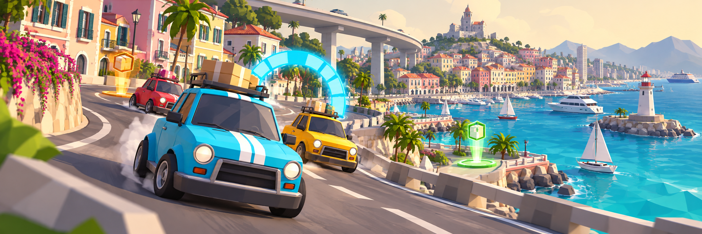

# Delivery Dash

[](https://github.com/aranlucas/delivery-dash/actions/workflows/ci.yml)
[](license)


**Your order is up. The harbor is your racetrack.**

Delivery Dash is a browser-based multiplayer 3D racing game for up to eight friends. Race the clock, chase the next drop-off, or leave the finish line behind and cruise the coastal city together.



_Illustrated cover art; see the game modes below for implemented gameplay._

## Game modes

| Mode              | Objective                                                                                                       |
| ----------------- | --------------------------------------------------------------------------------------------------------------- |
| Delivery Race     | Be the first to complete three pickup and drop-off runs.                                                        |
| Rush Hour         | Complete the most deliveries in three minutes. Orders continue throughout the round; equal totals share a rank. |
| Checkpoint Sprint | Reach eight numbered gates in order. The first driver through the final gate wins.                              |
| Free Drive        | Explore, drift, boost, and jump without a timer or finish line. Friends can join while you drive.               |

The first driver sets the room's mode. Joining drivers use that same mode. Ready up in the lobby to start; completed races return to the lobby for a rematch after ten seconds. Use **Change mode / Leave** to return to the menu.

Drive with **WASD** or the **arrow keys**, hold **Space** to drift and release it for a charged rush, and hold **Shift** to boost. The cyan checkpoint gates are passable markers; delivery modes use orange pickup and green drop-off markers.

Press **V** or choose **City View** above the minimap to inspect the whole island. Drag to orbit,
right-drag to pan, and scroll to zoom. The camera panel includes an overhead view, your car, and
all five landmarks; **Home** fits the island again. **Esc** or **V** returns to driving immediately.
Your car stays in place during inspection while the room's session continues.

For planned work, see the [feature roadmap](ROADMAP.md) and [arcade art direction](design/arcade-direction.md).
Asset sources, rebuild steps, and authoring contracts are in the [asset guide](assets/blender/readme.md).

## Run locally

Requires Node.js 24–26 and the pnpm version pinned in `package.json`. Enable Corepack's pnpm shim if your system pnpm is older.

```bash
corepack enable pnpm
pnpm install --frozen-lockfile
pnpm dev
```

Open <https://delivery-dash.localhost>. `pnpm dev` runs through [Portless](https://github.com/vercel-labs/portless) (a dev dependency); its first run may ask for `sudo` to bind port 443 and trust a local certificate.

## Verify

```bash
pnpm build
pnpm test
pnpm lint
pnpm format:check
```

`pnpm build` generates Worker types in ignored `.cloudflare/types/index.d.ts` before
typechecking. Run it before standalone `pnpm typecheck` or `pnpm lint` on a fresh checkout,
and regenerate types after changing bindings in [`cloudflare.config.ts`](cloudflare.config.ts).
The development server also generates these types. Unit tests run in Node without a local server.

With the local server running, exercise the real room protocol and all four modes:

```bash
TEST_GAME_URL=https://delivery-dash.localhost pnpm test:integration
TEST_GAME_URL=https://delivery-dash.localhost TEST_GAME_RUSH_TIMER=1 TEST_GAME_RECONNECT=1 pnpm test:integration
```

The second command also waits for Rush Hour's actual three-minute server deadline and checks
reconnection and the next round. Without `TEST_GAME_URL`, the runner defaults to
`http://localhost:5173`; use the origin of your local server.

## Room authority

The server owns room membership, mode, objective progress, and race deadlines. Movement is
client-authoritative: server proximity checks do not validate driving physics. The client and
server generate the same city and orders from a shared seed.

Room state and phase alarms commit together before clients receive a transition. Durable Object
alarms and WebSocket attachments let rooms recover across hibernation; an in-memory timer or
player map alone cannot preserve that behavior. Wire types and validation live in
[`protocol.ts`](src/shared/protocol.ts) and [`wire-schema.ts`](src/shared/wire-schema.ts);
room behavior lives in [`room-core.ts`](src/worker/room-core.ts).

## Deploy

```bash
pnpm deploy:dry-run
pnpm exec cf auth login
pnpm deploy
```

Keep local secrets in ignored `.dev.vars` files.

Both deployment commands build and typecheck before using the production Build Output.
`deploy:dry-run` adds `--dry-run` to validate packaging without uploading. `RaceRoom`'s SQLite
storage is declared in `worker.exports` in `cloudflare.config.ts`.
